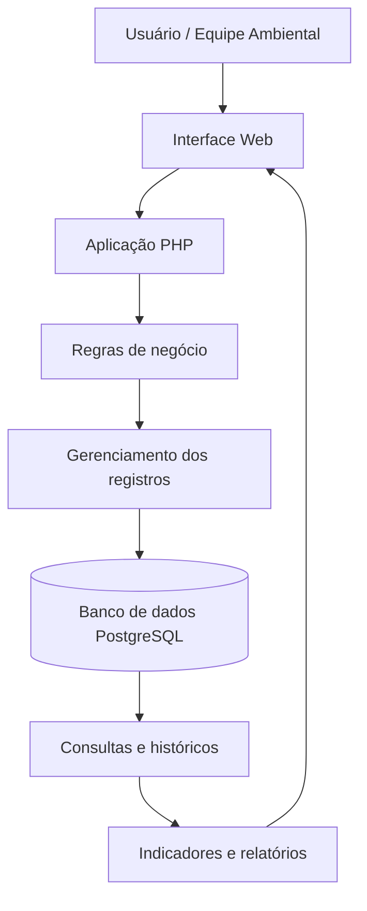

# 
 PHÝSIS 

<h3 align="center">Preservation · Habitats · Yield · Species · Indicators · Sustainability</h3>

  Plataforma de registro e monitoramento da recuperação ambiental e da biodiversidade.

  
  
  
  
  
  
  

---

<h2> Sobre o projeto</h2>

O **PHÝSIS** é um projeto de desenvolvimento de software inspirado no conceito grego de *Phýsis* (Φύσις), associado à natureza, à origem, ao crescimento e ao desenvolvimento da vida.

A proposta consiste no desenvolvimento de uma plataforma digital para apoiar o **registro, a organização e o monitoramento de informações relacionadas à recuperação ambiental e à biodiversidade** em áreas submetidas a processos de restauração ecológica.

O sistema busca centralizar dados sobre áreas monitoradas, observações de fauna, registros fotográficos e indicadores ambientais, permitindo acompanhar evidências da evolução dos ecossistemas ao longo do tempo.

Um dos principais focos é possibilitar o acompanhamento da presença e do retorno de espécies da fauna em ambientes em recuperação, utilizando registros organizados para contribuir com a análise dos resultados das ações de restauração.

Mais do que armazenar informações, o PHÝSIS pretende transformar observações ambientais em dados organizados, históricos e indicadores que auxiliem o acompanhamento da recuperação da biodiversidade.

<h2> Objetivos</h2>

<table>
  <tr>
    <td align="center" width="33%">
       
      <strong>Preservação</strong> 
      Contribuir para o acompanhamento de áreas em recuperação ambiental.
    </td>
    <td align="center" width="33%">
       
      <strong>Monitoramento</strong> 
      Registrar evidências da presença e do retorno da fauna.
    </td>
    <td align="center" width="33%">
       
      <strong>Indicadores</strong> 
      Organizar dados para acompanhar resultados ambientais.
    </td>
  </tr>
</table>

---

<h2>
  
  Contexto de aplicação
</h2>

O PHÝSIS foi concebido para atender às necessidades de organização e acompanhamento de projetos de recuperação ambiental, especialmente aqueles que envolvem o monitoramento da biodiversidade.

A proposta considera o contexto de atuação de profissionais e instituições ligados à consultoria ambiental, à recuperação de áreas degradadas e ao acompanhamento de ecossistemas.

Entre as possibilidades de aplicação estão:

- Registro e acompanhamento de áreas em processo de restauração.
- Organização de observações e evidências da fauna.
- Histórico de monitoramento da biodiversidade.
- Comparação de registros realizados em diferentes períodos.
- Organização de indicadores e resultados ambientais.

### Nosso propósito

O PHÝSIS nasce com o propósito de aproximar tecnologia e conservação ambiental, oferecendo uma ferramenta que facilite a organização das informações coletadas em campo e permita acompanhar a evolução da biodiversidade.

A proposta é contribuir para que os resultados das ações de restauração não sejam observados apenas pela recuperação da vegetação, mas também pelas evidências de retorno e permanência da vida nesses ambientes.

> Restaurar um ecossistema é criar condições para que a vida volte a florescer. Monitorar esse processo é transformar cada evidência em conhecimento.

> Nosso objetivo é transformar observações ambientais em informações organizadas, permitindo acompanhar a evolução da biodiversidade ao longo do tempo.

---

<h2> Módulos do sistema</h2>

A plataforma está planejada em módulos integrados, destinados à organização dos dados ambientais e ao acompanhamento da recuperação da biodiversidade.

<table>
  <tr>
    <td width="50%" valign="top">
      <h3> 01. Dashboard</h3>
      Painel de indicadores e visão geral dos projetos.

      - Áreas monitoradas.
      - Registros de fauna realizados.
      - Espécies observadas.
      - Atividades de monitoramento.
      - Indicadores e gráficos.
    </td>
    <td width="50%" valign="top">
      <h3> 02. Gestão de áreas</h3>
      Cadastro e organização das áreas em recuperação.

      - Identificação das áreas.
      - Localização geográfica.
      - Características ambientais.
      - Informações sobre restauração.
      - Histórico de acompanhamento.
    </td>
  </tr>
  <tr>
    <td width="50%" valign="top">
      <h3> 03. Monitoramento da fauna</h3>
      Registro de observações da biodiversidade.

      - Cadastro de observações.
      - Identificação de espécies.
      - Data e localização.
      - Fotografias e evidências.
      - Informações complementares.
    </td>
    <td width="50%" valign="top">
      <h3> 04. Catálogo de espécies</h3>
      Organização das espécies registradas.

      - Nome popular e científico.
      - Grupo e classificação.
      - Fotografias de referência.
      - Características das espécies.
      - Histórico de observações.
    </td>
  </tr>
  <tr>
    <td width="50%" valign="top">
      <h3> 05. Histórico de monitoramento</h3>
      Acompanhamento dos registros ao longo do tempo.

      - Histórico de visitas.
      - Registros por período.
      - Observações anteriores.
      - Comparação de registros.
      - Evolução das áreas monitoradas.
    </td>
    <td width="50%" valign="top">
      <h3> 06. Mapeamento ambiental</h3>
      Visualização espacial das informações.

      - Localização das áreas.
      - Pontos de observação.
      - Distribuição dos registros.
      - Referências geográficas.
      - Possível integração com mapas e imagens aéreas.
    </td>
  </tr>
  <tr>
    <td width="50%" valign="top">
      <h3> 07. Indicadores ambientais</h3>
      Organização de dados para análise da recuperação.

      - Quantidade de registros.
      - Diversidade de espécies observadas.
      - Frequência de observações.
      - Distribuição por área e período.
      - Indicadores de acompanhamento.
    </td>
    <td width="50%" valign="top">
      <h3> 08. Relatórios ambientais</h3>
      Consolidação das informações monitoradas.

      - Relatórios por área.
      - Registros por espécie.
      - Análise por período.
      - Histórico de atividades.
      - Exportação de informações.
    </td>
  </tr>
</table>

---

<h2> Arquitetura da solução</h2>

A solução está sendo planejada como uma aplicação web, utilizando PHP para o processamento das funcionalidades e PostgreSQL para o armazenamento e gerenciamento dos dados.

A arquitetura deverá permitir a organização das informações ambientais em uma estrutura centralizada, possibilitando o acesso aos registros, históricos e indicadores por meio da interface da plataforma.

### Visão geral

### Organização conceitual

| Camada | Responsabilidade |
|---|---|
| Interface Web | Apresentação das informações e interação com os usuários. |
| Aplicação PHP | Processamento das funcionalidades da plataforma. |
| Regras de negócio | Organização e validação das operações do sistema. |
| Persistência | Comunicação com o banco de dados. |
| PostgreSQL | Armazenamento dos dados ambientais e históricos. |

### Fluxo de informações

- O usuário acessa a plataforma por meio da interface web.
- As informações são processadas pela aplicação PHP.
- Os dados passam pelas regras de validação e organização.
- O PostgreSQL armazena os registros e históricos.
- As informações armazenadas podem alimentar consultas, indicadores e relatórios.

---

<h2> Tecnologias e ferramentas</h2>

### Linguagem de programação

  

### Interface e desenvolvimento web

  
  
  

### Banco de dados

  

### Versionamento e colaboração

  
  

---

<h2> Segurança e confiabilidade</h2>

A plataforma deverá considerar mecanismos para proteger os dados registrados e garantir maior confiabilidade na utilização das informações.

Entre os aspectos previstos estão:

- Autenticação de usuários.
- Controle de acesso por perfil.
- Validação dos dados cadastrados.
- Registro de alterações importantes.
- Tratamento de erros e exceções.
- Proteção das informações armazenadas.
- Organização dos históricos de monitoramento.

### Perfis de acesso previstos

| Perfil | Finalidade |
|---|---|
| Administrador | Gerenciamento geral da plataforma e dos acessos. |
| Gestor ambiental | Administração das áreas e acompanhamento dos projetos. |
| Técnico ambiental | Registro e atualização das informações de monitoramento. |
| Consultor / Pesquisador | Consulta das informações autorizadas e análise dos dados. |

---

<h2> Identidade visual</h2>

A identidade visual do **PHÝSIS** busca representar a relação entre natureza, biodiversidade e tecnologia.

A proposta combina tons inspirados em florestas, ambientes naturais e elementos orgânicos, mantendo uma aparência moderna e institucional.

| Elemento | Cor | Aplicação |
|---|---|---|
| Verde-floresta | `#174A3A` | Identidade principal e títulos. |
| Verde natural | `#0B8F70` | Destaques e elementos de natureza. |
| Azul-petróleo | `#0F6170` | Elementos tecnológicos e indicadores. |
| Dourado-terra | `#C49A45` | Destaques e detalhes visuais. |
| Areia-claro | `#E9E2D0` | Fundos e áreas de apoio. |

Os elementos gráficos da identidade devem explorar referências à vegetação, árvores, folhas, fauna e observação ambiental.

O nome **PHÝSIS** representa a essência do projeto: acompanhar os processos naturais de crescimento, transformação e recuperação da vida.

### Significado da sigla

| Letra | Termo | Significado |
|---|---|---|
| P | Preservation | Preservação dos ecossistemas. |
| H | Habitats | Habitats naturais e ambientes em recuperação. |
| Y | Yield | Resultados e evidências obtidos pelo monitoramento. |
| S | Species | Espécies e diversidade biológica. |
| I | Indicators | Indicadores ambientais. |
| S | Sustainability | Sustentabilidade e conservação a longo prazo. |

---

<h2> Etapas de desenvolvimento</h2>

1. Definição dos requisitos e do escopo funcional.
2. Modelagem dos dados e estrutura do banco de dados.
3. Desenvolvimento da interface web.
4. Implementação das funcionalidades em PHP.
5. Integração com o PostgreSQL.
6. Desenvolvimento dos módulos de monitoramento.
7. Implementação de consultas, indicadores e relatórios.
8. Testes, validação e documentação.

<h2> Status do projeto</h2>

**Fase atual:** planejamento e estruturação do projeto.

Os módulos apresentados representam a proposta funcional inicial do PHÝSIS. As funcionalidades serão desenvolvidas, testadas e validadas progressivamente, conforme a evolução do projeto e a definição dos requisitos.

---

  
  <strong> PHÝSIS — Revealing the Return of Life.</strong>
  

