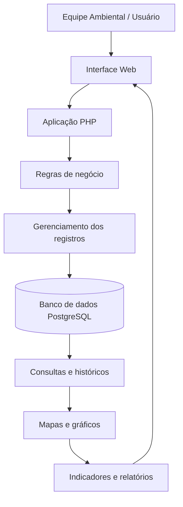

# 
 **P.H.Y.S.I.S** 

<h3 align="center">Preservation · Habitats · Yield · Species · Indicators · Sustainability</h3>

  Sistema de monitoramento da biodiversidade em áreas de restauração ambiental.

  
  
  
  
  
  
  

---

<h2> Sobre o projeto</h2>

O **P.H.Y.S.I.S** é uma proposta de desenvolvimento de software voltada ao **registro e acompanhamento da biodiversidade em áreas submetidas a projetos de restauração ambiental**.

A solução busca complementar o trabalho de recuperação de ecossistemas realizado pela **COLLARD Ambiental** e pelo **Sindicato Rural de Cruzeiro e Lavrinhas**, oferecendo uma ferramenta digital para organizar informações sobre a fauna silvestre observada nas propriedades e áreas monitoradas.

A plataforma permitirá cadastrar áreas de monitoramento, registrar observações de animais com fotografias, localização, data e identificação das espécies, além de manter um histórico das visitas e dos registros realizados.

As informações poderão ser organizadas em mapas, gráficos e relatórios, possibilitando acompanhar a evolução dos registros de biodiversidade ao longo do tempo.

Um dos principais objetivos é contribuir para uma avaliação mais abrangente dos resultados da restauração ambiental, considerando não apenas o desenvolvimento da vegetação, mas também as evidências de presença e ocorrência da fauna silvestre.

Mais do que armazenar informações, o PHYSIS pretende transformar registros ambientais em dados organizados e úteis para o acompanhamento dos projetos de restauração.

<h2> Objetivos</h2>

<table>
  <tr>
    <td align="center" width="33%">
       
      <strong>Restauração ambiental</strong> 
      Contribuir para o acompanhamento de áreas submetidas a processos de recuperação ecológica.
    </td>
    <td align="center" width="33%">
       
      <strong>Monitoramento da fauna</strong> 
      Registrar evidências da presença e ocorrência de animais silvestres.
    </td>
    <td align="center" width="33%">
       
      <strong>Análise ambiental</strong> 
      Organizar dados para acompanhar a evolução dos registros de biodiversidade.
    </td>
  </tr>
</table>

---

<h2>
  
  Parceria institucional
</h2>

O projeto **P.H.Y.S.I.S** é uma proposta desenvolvida em conjunto com a **COLLARD Ambiental** e o **Sindicato Rural de Cruzeiro e Lavrinhas**, instituições que atuam em iniciativas relacionadas à recuperação ambiental, conservação dos recursos naturais e desenvolvimento sustentável na região.

A atuação dessas instituições envolve ações voltadas à recuperação de áreas degradadas, ao acompanhamento de projetos ambientais e à promoção de práticas que contribuam para a conservação dos ecossistemas e o uso sustentável das propriedades rurais.

Nesse contexto, o acompanhamento da biodiversidade representa uma importante oportunidade para ampliar a compreensão dos resultados alcançados pelos projetos de restauração ambiental, permitindo observar não apenas a recuperação da vegetação, mas também as evidências do retorno da fauna silvestre aos ambientes monitorados.

### Nosso propósito

O **P.H.Y.S.I.S** nasce com o propósito de contribuir com esse trabalho, oferecendo uma ferramenta tecnológica para organizar e centralizar informações sobre a biodiversidade observada nas áreas em recuperação.

Por meio da plataforma, será possível cadastrar áreas de monitoramento, registrar observações de animais com fotografias, localização e identificação das espécies, além de manter um histórico dos levantamentos realizados.

As informações poderão ser organizadas em mapas, gráficos e relatórios, auxiliando no acompanhamento da evolução dos registros e na obtenção de indicadores que complementem a avaliação dos resultados da restauração ambiental.

**Acreditamos que a tecnologia pode ser uma importante aliada na conservação ambiental e no acompanhamento da biodiversidade.**

> Restaurar um ecossistema vai além de recuperar a vegetação. É também criar condições para que a vida silvestre volte a ocupar seu espaço.

> Nosso objetivo é transformar registros ambientais em informações úteis, contribuindo para um acompanhamento mais completo dos resultados da restauração.

### Conheça e apoie o trabalho das instituições

O trabalho desenvolvido pela COLLARD Ambiental e pelo Sindicato Rural de Cruzeiro e Lavrinhas contribui para fortalecer iniciativas de recuperação ambiental e sustentabilidade na região.

Conheça suas atividades, acompanhe suas iniciativas e apoie ações voltadas à conservação dos recursos naturais e à valorização do meio ambiente.

---

<h2>
  
  Contexto de aplicação
</h2>

O P.H.Y.S.I.S foi concebido para complementar o trabalho de recuperação de ecossistemas realizado pela **COLLARD Ambiental** e pelo **Sindicato Rural de Cruzeiro e Lavrinhas**.

A proposta considera a necessidade de organizar informações sobre a fauna silvestre observada nas propriedades e áreas submetidas a projetos de restauração ambiental.

A plataforma pretende oferecer um recurso complementar aos processos já existentes, facilitando o armazenamento, a consulta e o acompanhamento dos registros coletados durante as atividades de monitoramento.

Entre as possibilidades de aplicação estão:

- Cadastro e identificação das áreas monitoradas.
- Registro de observações da fauna silvestre.
- Armazenamento de fotografias e informações das espécies.
- Organização dos registros por localização e período.
- Histórico das visitas e atividades realizadas.
- Visualização das informações em mapas e gráficos.
- Geração de relatórios para acompanhamento dos projetos.

### Nosso propósito

O PHYSIS nasce com o propósito de aproximar tecnologia e conservação ambiental, oferecendo uma ferramenta que facilite a organização das informações coletadas em campo.

A proposta é contribuir para que os resultados das ações de restauração ambiental sejam avaliados de maneira mais abrangente, considerando também as evidências de presença e ocorrência da fauna silvestre nos ambientes em recuperação.

> Restaurar um ecossistema é criar condições para que a vida volte a florescer. Monitorar esse processo é transformar cada evidência em conhecimento.

> Nosso objetivo é transformar registros ambientais em informações organizadas e úteis para acompanhar a evolução da biodiversidade.

---

<h2> Módulos do sistema</h2>

A plataforma está planejada em módulos integrados, com desenvolvimento inicial concentrado nas funcionalidades essenciais de cadastro, registro, acompanhamento e geração de relatórios.

<table>
  <tr>
    <td width="50%" valign="top">
      <h3> 01. Dashboard</h3>
      Painel de indicadores e visão geral do monitoramento.

      - Áreas cadastradas.
      - Registros de fauna realizados.
      - Espécies observadas.
      - Histórico de atividades.
      - Gráficos e indicadores de acompanhamento.
    </td>
    <td width="50%" valign="top">
      <h3> 02. Gestão de áreas</h3>
      Cadastro e organização das propriedades e áreas monitoradas.

      - Identificação das áreas.
      - Localização geográfica.
      - Informações das propriedades.
      - Características das áreas em restauração.
      - Histórico de acompanhamento.
    </td>
  </tr>
  <tr>
    <td width="50%" valign="top">
      <h3> 03. Registro de fauna</h3>
      Registro de observações de animais silvestres.

      - Cadastro de observações.
      - Identificação das espécies.
      - Data e localização do registro.
      - Fotografias dos animais observados.
      - Informações complementares.
    </td>
    <td width="50%" valign="top">
      <h3> 04. Catálogo de espécies</h3>
      Organização das espécies identificadas nos monitoramentos.

      - Nome popular e científico.
      - Grupo e classificação.
      - Fotografias de referência.
      - Características das espécies.
      - Associação com os registros realizados.
    </td>
  </tr>
  <tr>
    <td width="50%" valign="top">
      <h3> 05. Histórico de monitoramento</h3>
      Acompanhamento das visitas e dos registros realizados ao longo do tempo.

      - Histórico de visitas.
      - Registros por período.
      - Observações anteriores.
      - Consulta de registros.
      - Evolução das observações nas áreas monitoradas.
    </td>
    <td width="50%" valign="top">
      <h3> 06. Mapeamento ambiental</h3>
      Visualização espacial das áreas e observações registradas.

      - Localização das áreas.
      - Pontos de observação.
      - Distribuição dos registros.
      - Referências geográficas.
      - Visualização das informações em mapas.
    </td>
  </tr>
  <tr>
    <td width="50%" valign="top">
      <h3> 07. Indicadores de biodiversidade</h3>
      Organização dos dados para análise da evolução dos registros.

      - Quantidade de registros.
      - Diversidade de espécies observadas.
      - Frequência de observações.
      - Distribuição por área e período.
      - Gráficos de acompanhamento.
    </td>
    <td width="50%" valign="top">
      <h3> 08. Relatórios ambientais</h3>
      Consolidação das informações de monitoramento.

      - Relatórios por área.
      - Registros por espécie.
      - Análise por período.
      - Histórico de visitas e observações.
      - Organização e exportação de informações.
    </td>
  </tr>
</table>

---

<h2> Arquitetura da solução</h2>

A solução está sendo planejada como uma aplicação web, utilizando **PHP** para o processamento das funcionalidades e **PostgreSQL** para o armazenamento e gerenciamento dos dados.

A arquitetura deverá permitir a centralização das informações ambientais em uma estrutura organizada, possibilitando o acesso aos registros, históricos, mapas, gráficos e relatórios por meio da interface da plataforma.

### Visão geral

### Organização conceitual

| Camada | Responsabilidade |
|---|---|
| Interface Web | Apresentação das informações e interação com os usuários. |
| Aplicação PHP | Processamento das funcionalidades da plataforma. |
| Regras de negócio | Organização e validação das operações do sistema. |
| Persistência | Comunicação com o banco de dados. |
| PostgreSQL | Armazenamento dos dados ambientais e históricos. |

### Fluxo de informações

- O usuário acessa a plataforma por meio da interface web.
- As informações são inseridas por meio dos formulários de cadastro e registro.
- Os dados passam pelas regras de validação e organização.
- O PostgreSQL armazena os registros e históricos.
- As informações armazenadas podem alimentar consultas, mapas, gráficos e relatórios.

---

<h2> Tecnologias e ferramentas</h2>

### Linguagem de programação

  

### Interface e desenvolvimento web

  
  
  

### Banco de dados

  

### Versionamento e colaboração

  
  

---

<h2> Segurança e confiabilidade</h2>

A plataforma deverá considerar mecanismos para proteger os dados registrados e garantir maior confiabilidade na utilização das informações.

Entre os aspectos previstos estão:

- Autenticação de usuários.
- Controle de acesso por perfil.
- Validação dos dados cadastrados.
- Registro de alterações importantes.
- Tratamento de erros e exceções.
- Proteção das informações armazenadas.
- Organização dos históricos de monitoramento.

### Perfis de acesso previstos

| Perfil | Finalidade |
|---|---|
| Administrador | Gerenciamento geral da plataforma e dos acessos. |
| Gestor ambiental | Administração das áreas e acompanhamento dos projetos. |
| Técnico ambiental | Registro e atualização das informações de monitoramento. |
| Consultor / Pesquisador | Consulta das informações autorizadas e análise dos dados. |

---

<h2> Identidade visual</h2>

A identidade visual do **PHYSIS** busca representar a relação entre natureza, biodiversidade e tecnologia.

A proposta combina tons inspirados em florestas, ambientes naturais e elementos orgânicos, mantendo uma aparência moderna e institucional.

| Elemento | Cor | Aplicação |
|---|---|---|
| Verde-floresta | `#174A3A` | Identidade principal e títulos. |
| Verde natural | `#0B8F70` | Destaques e elementos de natureza. |
| Azul-petróleo | `#0F6170` | Elementos tecnológicos e indicadores. |
| Dourado-terra | `#C49A45` | Destaques e detalhes visuais. |
| Areia-claro | `#E9E2D0` | Fundos e áreas de apoio. |

Os elementos gráficos da identidade devem explorar referências à vegetação, árvores, folhas, fauna e observação ambiental.

O nome **PHYSIS** é inspirado no conceito grego de *Phýsis* (Φύσις), associado à natureza, à origem, ao crescimento e ao desenvolvimento da vida.

### Significado da sigla

| Letra | Termo | Significado |
|---|---|---|
| P | Preservation | Preservação dos ecossistemas. |
| H | Habitats | Habitats naturais e ambientes em recuperação. |
| Y | Yield | Resultados e evidências obtidos pelo monitoramento. |
| S | Species | Espécies e diversidade biológica. |
| I | Indicators | Indicadores ambientais. |
| S | Sustainability | Sustentabilidade e conservação a longo prazo. |

---

<h2> Etapas de desenvolvimento</h2>

1. Levantamento de requisitos junto às instituições parceiras.
2. Definição das funcionalidades essenciais e do escopo inicial.
3. Modelagem dos dados e estrutura do banco de dados.
4. Desenvolvimento da interface web.
5. Implementação das funcionalidades em PHP.
6. Integração com o PostgreSQL.
7. Desenvolvimento dos módulos de cadastro e monitoramento.
8. Implementação de consultas, mapas, gráficos e relatórios.
9. Testes, validação com as necessidades identificadas e documentação.

<h2> Possibilidades futuras</h2>

Após a implementação e validação das funcionalidades essenciais, o PHYSIS poderá evoluir com recursos adicionais de coleta e integração de dados ambientais.

Entre as possibilidades estão:

- Integração com armadilhas fotográficas.
- Organização de dados de monitoramento acústico.
- Incorporação de informações obtidas por levantamentos com drones.
- Ampliação das análises temporais e comparativas da biodiversidade.

Essas funcionalidades dependerão da viabilidade técnica e das necessidades identificadas junto às instituições parceiras.

<h2> Status do projeto</h2>

**Fase atual:** planejamento e estruturação da proposta.

O desenvolvimento será orientado pelas necessidades reais da COLLARD Ambiental e do Sindicato Rural de Cruzeiro e Lavrinhas, buscando oferecer uma ferramenta viável e complementar aos processos já existentes.

A versão inicial priorizará as funcionalidades essenciais de cadastro de áreas, registro de fauna, acompanhamento dos históricos e geração de relatórios.

Os demais módulos e recursos serão desenvolvidos e validados progressivamente, conforme a evolução do projeto e a definição dos requisitos.

---

  
  <strong> P.H.Y.S.I.S — Revelando o Retorno da Vida.</strong>
  

